

<picture>
  <source media="(max-width: 600px)" srcset="assets/redline/hero-mobile.svg">
  
</picture>

   

<picture>
  <source media="(prefers-color-scheme: dark)" srcset="assets/banner/dark.svg">
  <source media="(prefers-color-scheme: light)" srcset="assets/banner/light.svg">
  
</picture>

<h3 align="center">
<picture>
  <source media="(max-width: 600px)" srcset="assets/redline/header-02-mobile.svg">
  
</picture>
</h3>

<picture>
  <source media="(max-width: 600px)" srcset="assets/redline/generated/stats-mobile.svg">
  
</picture>

<h3 align="center">
<picture>
  <source media="(max-width: 600px)" srcset="assets/redline/header-03-mobile.svg">
  
</picture>
</h3>

<picture>
  <source media="(max-width: 600px)" srcset="assets/redline/about-mobile.svg">
  
</picture>

<h3 align="center">
<picture>
  <source media="(max-width: 600px)" srcset="assets/redline/header-04-mobile.svg">
  
</picture>
</h3>

<picture>
  <source media="(max-width: 600px)" srcset="assets/redline/education-mobile.svg">
  
</picture>

<h3 align="center">
<picture>
  <source media="(max-width: 600px)" srcset="assets/redline/header-05-mobile.svg">
  
</picture>
</h3>

<picture>
  <source media="(max-width: 600px)" srcset="assets/redline/experience-mobile.svg">
  
</picture>

<h3 align="center">
<picture>
  <source media="(max-width: 600px)" srcset="assets/redline/header-06-mobile.svg">
  
</picture>
</h3>

 <a href="https://nodejs.org/docs/latest/api/">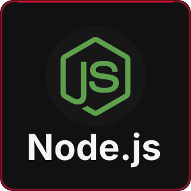</a>  <a href="https://docs.flutter.dev/">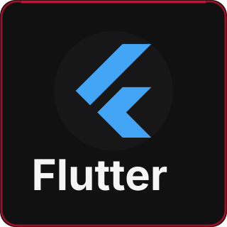</a> 

<a href="https://en.cppreference.com/w/c">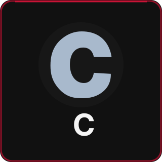</a> <a href="https://en.cppreference.com/w/cpp">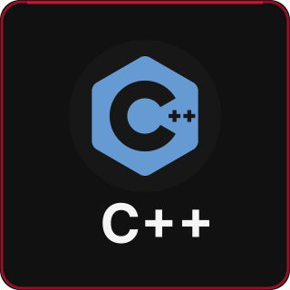</a> <a href="https://dev.java/learn/">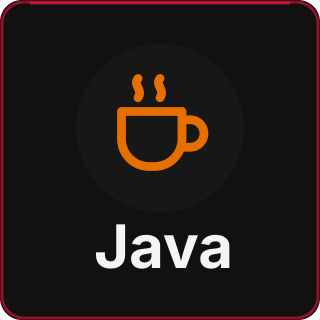</a>  <a href="https://developer.mozilla.org/docs/Web/CSS">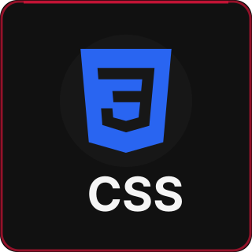</a>

<h3 align="center">
<picture>
  <source media="(max-width: 600px)" srcset="assets/redline/header-07-mobile.svg">
  
</picture>
</h3>

<a href="https://uiusvs.netlify.app/">
<picture>
  <source media="(max-width: 600px)" srcset="assets/redline/project-uiusvs-mobile.svg">
  
</picture>
</a>

<a href="https://github.com/souravsahapartho/uiu-student-brain">
<picture>
  <source media="(max-width: 600px)" srcset="assets/redline/project-studentbrain-mobile.svg">
  
</picture>
</a>

<a href="https://github.com/souravsahapartho/UIU-Learning-Management-System-LMS-">
<picture>
  <source media="(max-width: 600px)" srcset="assets/redline/project-elms-mobile.svg">
  
</picture>
</a>

<a href="https://sourav.com.bd/project/uiu-cgpa-calculator">
<picture>
  <source media="(max-width: 600px)" srcset="assets/redline/project-cgpa-mobile.svg">
  
</picture>
</a>

<h3 align="center">
<picture>
  <source media="(max-width: 600px)" srcset="assets/redline/header-08-mobile.svg">
  
</picture>
</h3>

<picture>
  <source media="(prefers-color-scheme: dark)" srcset="https://raw.githubusercontent.com/souravsahapartho/souravsahapartho/output/github-contribution-grid-snake.svg">
  <source media="(prefers-color-scheme: light)" srcset="https://raw.githubusercontent.com/souravsahapartho/souravsahapartho/output/github-contribution-grid-snake-light.svg">
  
</picture>

<h3 align="center">
<picture>
  <source media="(max-width: 600px)" srcset="assets/redline/header-09-mobile.svg">
  
</picture>
</h3>

<a href="https://github.com/souravsahapartho?tab=achievements"></a> <a href="https://github.com/souravsahapartho?tab=achievements"></a> <a href="https://github.com/souravsahapartho?tab=achievements"></a>

<a href="https://github.com/souravsahapartho/uiu-student-brain/releases/tag/v2.6.7"></a> <a href="https://apkpure.com/p/edu.uiu.cgpacalculator.ai"></a> <a href="https://t.me/uiu_student_helper_bot"></a>

<picture></picture>

<!-- BLOG-POST-LIST:START -->- 🔗 [Gemini Omni and Google Flow: The Future of AI-Powered Content Creation](https://blog.sourav.com.bd/article/gemini-omni-google-flow)
- 🔗 [Instagram Instants Is Here — But Users Are Still Trying to Figure Out Why](https://blog.sourav.com.bd/article/instagram-instants)
- 🔗 [Why Developers and Power Users Are Switching to Claude in 2026](https://blog.sourav.com.bd/article/claude-ai-2026)
- 🔗 [IP Phone Systems Drive Global Shift Toward Cloud-Based Business Communication](https://blog.sourav.com.bd/article/ip-phone)
- 🔗 [How to Buy Bitcoin: A Beginner's Guide](https://blog.sourav.com.bd/article/how-to-buy-bitcoin)
<!-- BLOG-POST-LIST:END -->

<h3 align="center">
<picture>
  <source media="(max-width: 600px)" srcset="assets/redline/header-10-mobile.svg">
  
</picture>
</h3>

<picture>
  <source media="(max-width: 600px)" srcset="assets/redline/contact-mobile.svg">
  
</picture>

<a href="https://github.com/souravsahapartho"></a> <a href="https://sourav.com.bd"></a>
<a href="https://www.linkedin.com/in/souravsahapartho/"></a> <a href="mailto:hello@sourav.com.bd"></a>

