<!-- Generated by scripts/render_cards.py (daily workflow). Edit the layout in main() there, not this file. -->


<a href="https://sourav.com.bd"></a>
<a href="https://www.linkedin.com/in/souravsahapartho/"></a>
<a href="https://blog.sourav.com.bd"></a>


<a href="https://github.com/souravsahapartho/UIU-Files"></a>
<a href="https://github.com/souravsahapartho/uiu-student-brain"></a>

<a href="https://github.com/souravsahapartho/UIU-Student-Assistant-Telegram-Bot"></a>
<a href="https://github.com/souravsahapartho/UIU-Learning-Management-System-LMS-"></a>


<a href="https://blog.sourav.com.bd/article/gemini-omni-google-flow"></a>
<a href="https://blog.sourav.com.bd/article/instagram-instants"></a>

<a href="https://blog.sourav.com.bd/article/claude-ai-2026"></a>
<a href="https://blog.sourav.com.bd/article/ip-phone"></a>

<a href="https://blog.sourav.com.bd/article/how-to-buy-bitcoin"></a>

<a href="https://sourav.com.bd"></a>

