

  <a href="https://sourav.com.bd"></a>

<b>Full-stack developer · CSE @ United International University · building tools my campus actually uses.</b>

  <a href="#kick-off">Kick-off</a> · <a href="#starting-xi">Starting XI</a> · <a href="#the-pitch">The Pitch</a> · <a href="#scoreboard">Scoreboard</a> · <a href="#season-performance">Season</a> · <a href="#trophy-room">Trophy Room</a> · <a href="#press-box">Press Box</a> · <a href="#full-time">Full Time</a>

### Kick-off

  <a href="https://sourav.com.bd">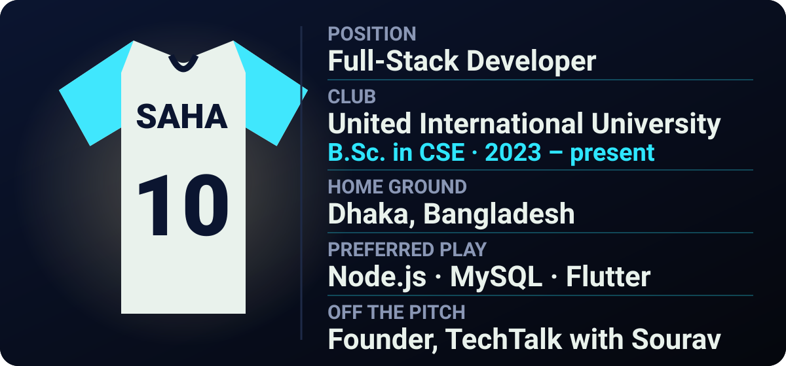</a>

I'm <b>Sourav Saha</b>, a CSE student at United International University in Dhaka. 
I build full-stack web apps with Node.js, Express and MySQL, and Android apps with Flutter. Most of what I ship serves the UIU community. 
I also write at <a href="https://blog.sourav.com.bd">TechTalk with Sourav</a>. 
<b>Currently:</b> working on <a href="https://github.com/souravsahapartho/mess-meal-calculation">mess-meal-calculation</a> and the <a href="https://github.com/souravsahapartho/uiu-student-brain">Student Brain</a> mobile app.

### Starting XI

<a href="https://github.com/souravsahapartho/uiu-student-brain/tree/main/mobile"></a> <a href="https://github.com/souravsahapartho/UIU-Learning-Management-System-LMS-"></a> <a href="https://github.com/souravsahapartho/English_Janala_website"></a>

<a href="https://sourav.com.bd/project/uiusvs-website"></a> <a href="https://github.com/souravsahapartho/mess-meal-calculation"></a> <a href="https://github.com/souravsahapartho/DBMS"></a>

<a href="https://github.com/souravsahapartho/UIU-Student-Assistant-Telegram-Bot"></a> <a href="https://github.com/souravsahapartho/DSA-I"></a> <a href="https://github.com/souravsahapartho/OOP-with-Java"></a>

<a href="https://github.com/souravsahapartho?tab=repositories"></a>

<b>Bench:</b> <a href="https://tailwindcss.com/docs">Tailwind CSS</a> · <a href="https://dart.dev/guides">Dart</a> · <a href="https://developers.cloudflare.com/workers/">Cloudflare Workers</a> · <a href="https://www.figma.com/">Figma</a>

### The Pitch

<a href="https://uiusvs.netlify.app/"></a> 

UIUSVS: <a href="https://uiusvs.netlify.app/">Live site</a> · <a href="https://sourav.com.bd/project/uiusvs-website">Case study</a> &nbsp;|&nbsp; Student Brain: <a href="https://uiu-student-brain.vercel.app">Live web</a> · <a href="https://github.com/souravsahapartho/uiu-student-brain/releases/tag/v2.6.7">Android v2.6.7</a>

<a href="https://github.com/souravsahapartho/UIU-Learning-Management-System-LMS-"></a> <a href="https://sourav.com.bd/project/uiu-cgpa-calculator"></a>

eLMS: <a href="https://uiuelms.netlify.app/">Live site</a> · <a href="https://sourav.com.bd/project/elms-figma">Figma design</a> &nbsp;|&nbsp; CGPA AI: <a href="https://apkpure.com/p/edu.uiu.cgpacalculator.ai">Android app</a>

<a href="https://github.com/souravsahapartho/UIU-Student-Assistant-Telegram-Bot"></a> 

Student Assistant: <a href="https://t.me/uiu_student_helper_bot">Open the bot</a> &nbsp;|&nbsp; Emotion AI: <a href="https://human-emotion-detection-from-text.onrender.com/">Live demo</a>

<b>Bench:</b> <a href="https://mess-meal-calculation.vercel.app/">Mess Meal Calculation</a> · <a href="https://souravsahapartho.github.io/English_Janala_website/">English Janala</a> · <a href="https://sourav.com.bd/project/taxplan">TaxPlan BD</a> · <a href="https://sourav.com.bd/project/saveabite-website">SaveAbite</a> · <a href="https://souravsahapartho.github.io/payoo-mobile-app/">Payoo</a> · <a href="https://souravsahapartho.github.io/Emergency-Hotline-website/">Emergency Hotline</a>

  
<b>Take the penalty</b> — tap to shoot

   
  

    
  

### Scoreboard

  <a href="https://github.com/souravsahapartho?tab=repositories"></a>

Updated daily by GitHub Actions. Streak and best run are in days, contributions cover the last 12 months. 
<a href="https://github.com/souravsahapartho?tab=repositories">Repositories</a> · <a href="https://github.com/souravsahapartho?tab=repositories&sort=stargazers">Most starred</a> · <a href="https://github.com/souravsahapartho?tab=followers">Followers</a> · <a href="https://github.com/souravsahapartho?tab=following">Following</a>

### Season Performance

  

Every green square is a matchday.

#### Training Ground

<a href="https://github.com/souravsahapartho/DSA-I">DSA I</a> · <a href="https://github.com/souravsahapartho/DSA-II">DSA II</a> · <a href="https://github.com/souravsahapartho/LeetCode-Problems">LeetCode</a> · <a href="https://github.com/souravsahapartho/OOP-with-Java">OOP with Java</a> · <a href="https://github.com/souravsahapartho/DBMS">DBMS</a> · <a href="https://github.com/souravsahapartho/AI-Lab">AI Lab</a> · <a href="https://codeforces.com/profile/souravsahapartho">Codeforces</a>

### Trophy Room

  <a href="https://github.com/souravsahapartho?tab=achievements"></a>

<b>Achievements:</b> <a href="https://github.com/souravsahapartho?tab=achievements">YOLO · Pull Shark · Quickdraw</a> 
<b>Shipped:</b> <a href="https://github.com/souravsahapartho/uiu-student-brain/releases/tag/v2.6.7">Student Brain for Android</a> · <a href="https://apkpure.com/p/edu.uiu.cgpacalculator.ai">UIU CGPA Calculator AI</a> · <a href="https://t.me/uiu_student_helper_bot">UIU Student Assistant bot</a> 
<b>Roles:</b> <a href="https://blog.sourav.com.bd">Founder, TechTalk with Sourav</a> · <a href="https://sourav.com.bd">Campus Ambassador, Creative IT Institute</a> · <a href="https://sourav.com.bd">Ex-Executive of HR, UIU EDF</a>

### Press Box

Match reports from [TechTalk with Sourav](https://blog.sourav.com.bd)

<!-- BLOG-POST-LIST:START -->- 🔗 [Gemini Omni and Google Flow: The Future of AI-Powered Content Creation](https://blog.sourav.com.bd/article/gemini-omni-google-flow)
- 🔗 [Instagram Instants Is Here — But Users Are Still Trying to Figure Out Why](https://blog.sourav.com.bd/article/instagram-instants)
- 🔗 [Why Developers and Power Users Are Switching to Claude in 2026](https://blog.sourav.com.bd/article/claude-ai-2026)
- 🔗 [IP Phone Systems Drive Global Shift Toward Cloud-Based Business Communication](https://blog.sourav.com.bd/article/ip-phone)
- 🔗 [How to Buy Bitcoin: A Beginner's Guide](https://blog.sourav.com.bd/article/how-to-buy-bitcoin)
<!-- BLOG-POST-LIST:END -->

### Full Time

  

<a href="https://sourav.com.bd">Website</a> · <a href="mailto:hello@sourav.com.bd">Email</a> · <a href="https://www.linkedin.com/in/souravsahapartho/">LinkedIn</a> · <a href="https://x.com/souravpartho">X</a> · <a href="https://www.facebook.com/souravsahapartho">Facebook</a> · <a href="https://www.instagram.com/souravsahapartho/">Instagram</a> · <a href="https://t.me/souravsahapartho">Telegram</a> · <a href="https://blog.sourav.com.bd">Blog</a>

